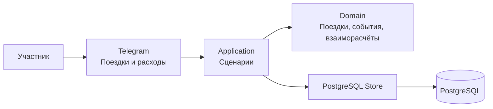
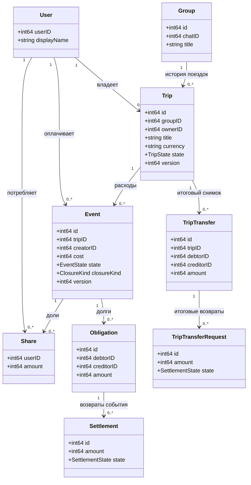
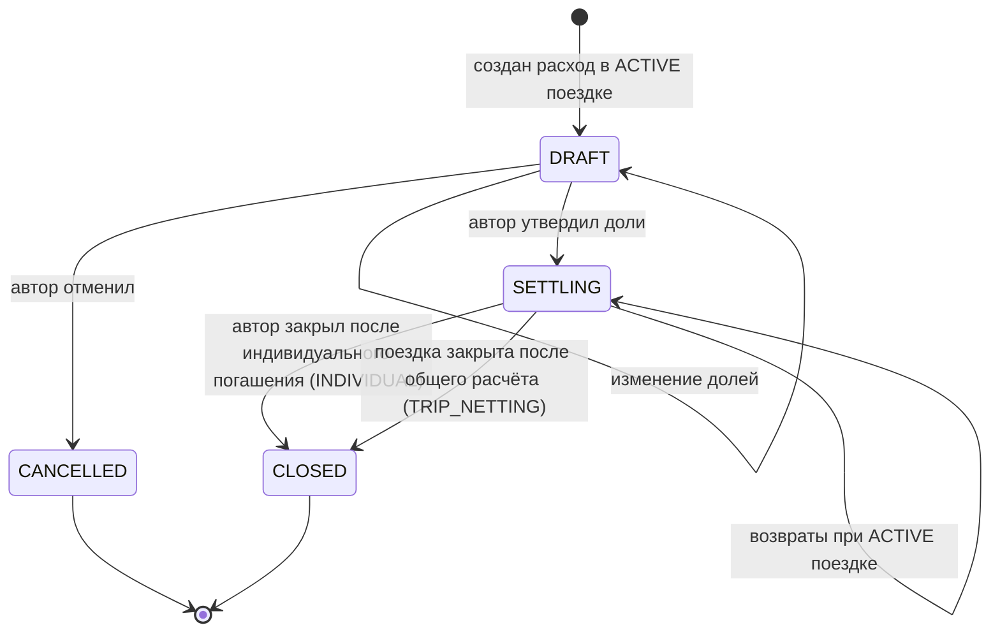
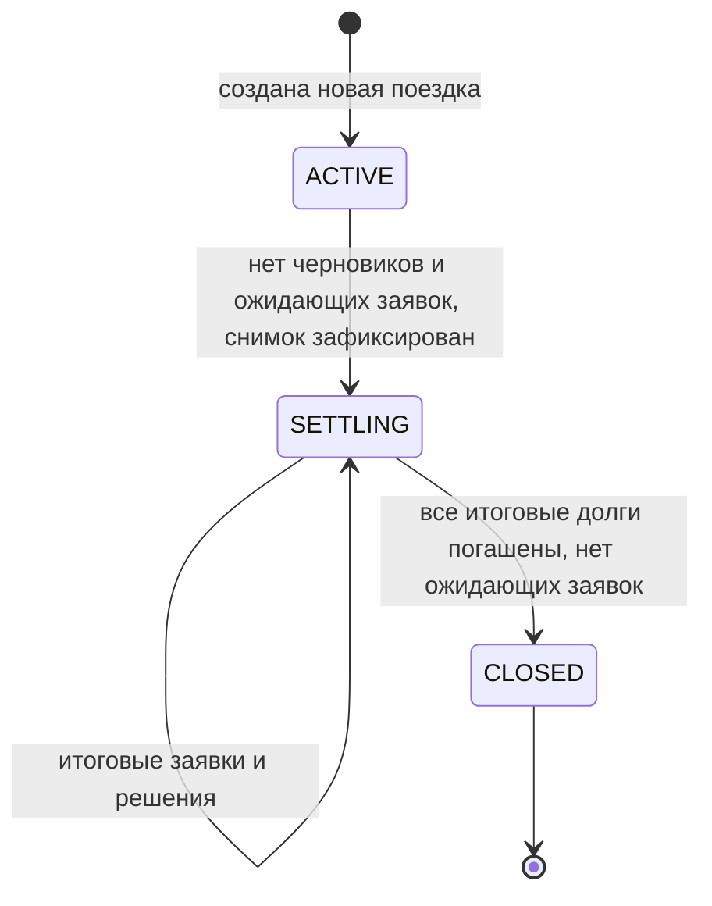
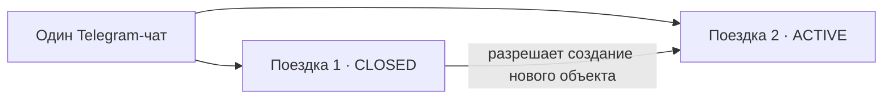
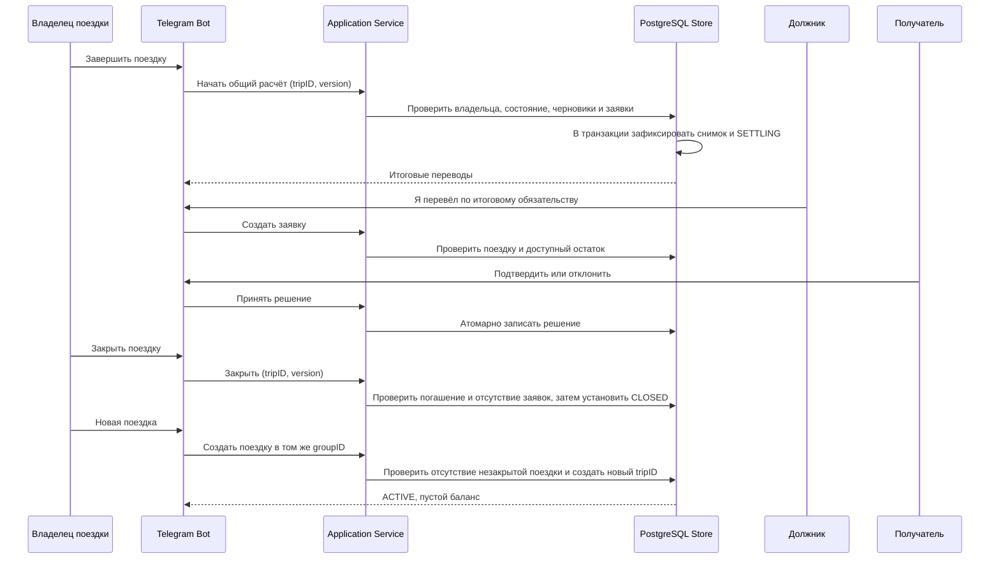

# Splitwise. Идея и архитектура

Telegram-бот для учёта совместных расходов. Участники указывают свои доли, подтверждают возвраты и закрывают поездку после общего расчёта. Один чат хранит историю нескольких поездок.

Версия от 22.11.2026

[Версия в PDF](SplitWise%20-%20идея%20и%20решение.pdf)

## Содержание

- [Часть 1. Продукт](#часть-1-продукт)
  - [Идея](#идея)
  - [Термины, границы и участники](#термины-границы-и-участники)
  - [Два способа расчёта](#два-способа-расчёта)
  - [Сценарии использования](#сценарии-использования)
  - [Пример общего расчёта](#пример-общего-расчёта)
- [Часть 2. Архитектура](#часть-2-архитектура)
  - [Основные объекты и обязанности](#основные-объекты-и-обязанности)
  - [Связи и финансовые ограничения](#связи-и-финансовые-ограничения)
  - [Архитектура и расчёт](#архитектура-и-расчёт)
  - [Диаграмма классов](#диаграмма-классов)
  - [Состояния события](#состояния-события)
  - [Состояния поездки и повторное использование чата](#состояния-поездки-и-повторное-использование-чата)
  - [Последовательность общего расчёта](#последовательность-общего-расчёта)
  - [Интерфейс и ограничения](#интерфейс-и-ограничения)

## Часть 1. Продукт

### Идея

**В одной фразе.** Бот превращает совместные траты из переписки в проверяемую историю расходов, долей и возвратов.

**Проблема.** Суммы и подтверждения теряются в сообщениях. При ручном сведении легко повторно взыскать уже погашенный долг, перепутать поездки или сделать лишние встречные переводы.

**Для кого.** Для групп, которые делят расходы на поездки, покупки и мероприятия и используют для этого общий Telegram-чат.

**Как устроено.**

1. В чате создают поездку, затем добавляют расходы. У каждого расхода один плательщик, а участники могут внести разные доли.
2. За расход можно рассчитаться отдельно. При завершении поездки бот учитывает подтверждённые возвраты и формирует итоговые переводы с взаимозачётом.
3. После погашения итоговых обязательств владелец закрывает поездку. В этом же чате можно создать следующую с нулевым балансом.

### Термины, границы и участники

| Термин | Значение |
| --- | --- |
| Группа (`Group`) | Постоянный контекст Telegram-чата, содержащий историю поездок. |
| Поездка (`Trip`) | Крупное событие: отдельный финансовый контекст со своими расходами и итогами. |
| Событие (`Event`) | Одна оплаченная трата внутри поездки, один плательщик. |
| Расчёт события | Погашение обязательств конкретного расхода без взаимозачёта с другими расходами. |
| Расчёт группы | Общий расчёт всех событий текущей поездки группы с учётом возвратов и взаимозачётом. Разные поездки не объединяются. |

Пользователь Telegram выступает участником, автором-плательщиком, должником, получателем или владельцем поездки. Владелец новой поездки — её создатель; создавать поездку может участник чата, когда предыдущая закрыта. У группы не более одной незакрытой поездки (`ACTIVE` или `SETTLING`). Это принятое ограничение целевого MVP: поездки идут последовательно.

Telegram доставляет сообщения и нажатия кнопок, PostgreSQL хранит записи. Бот не переводит деньги и не сверяет платежи с банком. Подтверждение получателя фиксирует его согласие с заявленным возвратом. Валюта — `RUB`; суммы хранятся целым числом копеек, без `float/double`.

### Два способа расчёта

**Отдельное событие.** В поездке `ACTIVE` автор утверждает доли, должники заявляют возвраты, получатель подтверждает их. После погашения всех обязательств и разрешения ожидающих заявок автор закрывает событие с признаком `INDIVIDUAL`. Остальные события и сама поездка остаются открытыми.

**Группа целиком.** Владелец переводит текущую поездку в `SETTLING`. Все черновики должны быть утверждены или отменены, все ожидающие заявки отдельных событий — разрешены. Система фиксирует чистые позиции по всем утверждённым событиям поездки, включая уже закрытые индивидуально; их расходы и подтверждённые возвраты дают нулевой остаточный вклад. Отменённые события исключаются.

После фиксации итогов новые расходы, доли и возвраты отдельных событий запрещены. Владелец может переименовать поездку по UC-02. Оставшиеся долги погашаются только через `TripTransferRequest`: это исключает двойной расчёт одного остатка. При полном погашении итоговых обязательств и отсутствии ожидающих заявок владелец закрывает поездку. Оставшиеся события `SETTLING` закрываются с признаком `TRIP_NETTING`. Это означает урегулирование в составе поездки; групповой перевод не записывается как возврат произвольного отдельного события. Индивидуальная история сохраняется, повторное взыскание исходного долга запрещено.

Если чистые позиции всех участников нулевые, список итоговых переводов пуст: поездку можно закрыть без фиктивных платежей. Нулевая сумма позиций сама по себе недостаточна — она выполняется и при непогашенных долгах.

### Сценарии использования

#### Роли и права

| Роль | Доступные действия |
| --- | --- |
| Участник чата | Создать поездку при отсутствии незакрытой, добавить расход в активную поездку, указать свою долю, просматривать доступную историю и обращаться к справке. |
| Автор-плательщик | Управлять своим черновиком, утвердить доли, решить заявки по своему расходу и закрыть погашенный расход. |
| Должник | Заявить возврат по собственному обязательству на сумму доступного остатка или его части. |
| Получатель | Подтвердить или отклонить адресованную ему заявку. В отдельном расходе это плательщик, при общем расчёте — получатель из итогового обязательства. |
| Владелец поездки | Переименовать незакрытую поездку, запустить общий расчёт и закрыть поездку. Остальные права определяются его ролью в конкретном расходе или переводе. |

В сценариях PASS описывает наблюдаемый результат успешного действия, а Альтернативы — допустимые ветки, отказы и восстановление. Все сценарии описывают целевое поведение. Названия кнопок используются как рабочие подписи.

#### Поездка и Telegram-чат

##### UC-01. Создать первую или следующую поездку

- **Кто и когда.** Любой участник группы, когда в ней ещё нет поездок или все поездки закрыты.
- **Ход.** Участник выбирает «Новая поездка», вводит название и подтверждает действие. Бот проверяет группу и создаёт поездку.
- **PASS.** Бот сообщает о создании поездки и показывает её карточку. Поездка получает новый ID, состояние `ACTIVE`, владельцем становится создатель, стартовый баланс равен нулю. История закрытых поездок доступна из того же чата.
- **Альтернативы.** Пустое название после удаления пробелов запрашивается повторно. Отмена ввода оставляет список поездок прежним. Если уже есть `ACTIVE` или `SETTLING`, бот показывает текущую поездку. Если два участника подтвердили создание одновременно, только первый успешно сохранённый запрос создаёт поездку, второй показывает созданную карточку. Повторная доставка подтверждения использует результат первой обработки.

##### UC-02. Переименовать поездку

- **Кто и когда.** Владелец поездки в состоянии `ACTIVE` или `SETTLING`.
- **Ход.** Владелец открывает карточку нужной поездки, выбирает «Переименовать поездку», вводит новое название и подтверждает. Бот проверяет владельца, состояние и версию поездки, затем сохраняет название.
- **PASS.** Бот подтверждает переименование, обновляет карточку поездки и показывает новое название в списках. Меняются название и версия той же поездки. Состояние, расходы, балансы, итоговые переводы и название Telegram-чата сохраняются.
- **Альтернативы.** Пустое название после удаления пробелов требует повторного ввода. Если название совпадает с текущим, бот сообщает об этом и сохраняет прежнюю версию. При отмене диалога название сохраняется. Чужая попытка переименования или попытка изменить закрытую поездку отклоняется. Если поездка изменилась во время ввода или её успели закрыть, бот просит открыть актуальную карточку. Повторное подтверждение не создаёт отдельной записи о переименовании.

#### Расход и распределение долей

##### UC-03. Создать расход

- **Кто и когда.** Участник группы при `Trip.ACTIVE`.
- **Ход.** Участник вызывает `/expense`, вводит название и стоимость в `RUB`, проверяет данные и подтверждает. Бот сохраняет черновик с автором в роли плательщика.
- **PASS.** Создаётся один `Event.DRAFT`, в группе появляется карточка с названием, стоимостью и действием «Моя доля». В балансе черновик пока не учитывается.
- **Альтернативы.** Пустое название, нулевая, отрицательная или некорректная сумма требуют повторного ввода. При отсутствии активной поездки бот предлагает открыть текущую карточку или начать новую поездку, если создание доступно. Если общий расчёт начался во время ввода, подтверждение расхода отклоняется.

##### UC-04. Указать или изменить свою долю

- **Кто и когда.** Участник чата, включая плательщика, пока расход в `DRAFT`, а поездка в `ACTIVE`.
- **Ход.** Участник нажимает «Моя доля», вводит сумму и подтверждает. Для существующей доли бот заменяет исходную сумму и пересчитывает итог с учётом замены.
- **PASS.** У участника хранится одна доля. Карточка показывает распределённую сумму и остаток. Плательщик может явно сохранить нулевую долю, например если оплатил покупку целиком за других.
- **Альтернативы.** Отрицательная или некорректная сумма отклоняется. Если сумма долей с учётом замены превысит стоимость, бот показывает доступный максимум. Нулевая доля участника не создаёт обязательства. При одновременных правках бот проверяет лимит с учётом уже сохранённых долей. После утверждения или отмены черновика запись недоступна.

##### UC-05. Утвердить доли

- **Кто и когда.** Автор расхода при `Event.DRAFT` и `Trip.ACTIVE`.
- **Ход.** Автор нажимает «Подвести итог». Бот проверяет, что доля автора явно внесена, а сумма всех долей точно равна стоимости, и создаёт обязательства перед плательщиком.
- **PASS.** Расход переходит в `SETTLING`, доли фиксируются. По каждой положительной доле другого участника создаётся одно обязательство. Если всю стоимость отнёс на себя плательщик, список обязательств пуст, расход можно сразу закрыть по UC-09.
- **Альтернативы.** При неполном распределении бот показывает недостающую сумму. Если отсутствует доля плательщика, бот просит её внести. Чужая попытка утверждения, повторное подтверждение или подтверждение по устаревшей карточке не создают обязательств.

##### UC-06. Отменить черновик расхода

- **Кто и когда.** Автор расхода при `Event.DRAFT` и `Trip.ACTIVE`.
- **Ход.** Автор выбирает отмену черновика и подтверждает её.
- **PASS.** Расход получает состояние `CANCELLED`, карточка показывает отмену. Расход и его доли остаются в истории, а финансовых обязательств по нему нет.
- **Альтернативы.** Отказ в диалоге подтверждения сохраняет черновик. Если черновик успели утвердить, отмена отклоняется. Чужая попытка отмены отклоняется. Команда `/cancel` завершает только текущий диалог ввода.

#### Расчёт отдельного расхода

##### UC-07. Заявить возврат по расходу

- **Кто и когда.** Должник по обязательству расхода в `SETTLING`, пока поездка `ACTIVE`.
- **Ход.** Должник выбирает «Я перевёл», проверяет получателя и вводит сумму. Доступно до суммы обязательства за вычетом подтверждённых и ожидающих заявок.
- **PASS.** Бот сохраняет `Settlement.PENDING`. Полная заявка резервирует весь доступный остаток, частичная — только заявленную сумму. Получатель видит заявку в личном интерфейсе, баланс пока прежний.
- **Альтернативы.** Неверная сумма требует повторного ввода. Если доступный остаток нулевой, бот показывает состояние погашения или ожидания решения. Сумма выше остатка отклоняется, в том числе при параллельном вводе. Чужое обязательство, закрытый расход и поездка в общем расчёте недоступны для записи.

##### UC-08. Подтвердить или отклонить возврат по расходу

- **Кто и когда.** Получатель по ожидающей заявке при `Trip.ACTIVE`.
- **Ход.** Получатель открывает заявку, проверяет должника и сумму, нажимает «Подтвердить» или «Отклонить».
- **PASS.** При подтверждении заявка получает `CONFIRMED`, погашенная сумма увеличивается, баланс обновляется. При отклонении заявка получает `REJECTED`, баланс сохраняется, сумма снова доступна для новой заявки. Должник может повторно заявить возврат по UC-07.
- **Альтернативы.** Чужая попытка запрещена. Если решение уже принято, бот показывает текущее состояние заявки. Из двух одновременных решений сохраняется первое.

##### UC-09. Закрыть рассчитанный расход

- **Кто и когда.** Автор расхода в `SETTLING`, пока поездка `ACTIVE`.
- **Ход.** Автор нажимает «Закрыть событие». Бот проверяет обязательства и заявки расхода.
- **PASS.** Когда все обязательства погашены и ожидающих заявок нет, расход становится `CLOSED` с признаком `INDIVIDUAL`. Следующие расходы и расчёт поездки доступны как прежде.
- **Альтернативы.** Бот показывает непогашенный остаток и ожидающие решения, если они есть. Расход без обязательств закрывается сразу. Если начат общий расчёт, закрытие такого расхода выполняется в составе поездки по UC-13.

#### Общий расчёт и закрытие поездки

##### UC-10. Зафиксировать общий расчёт

- **Кто и когда.** Владелец поездки в `ACTIVE`.
- **Ход.** Владелец выбирает «Завершить поездку». Бот проверяет черновики и ожидающие заявки расходов, вычисляет чистые позиции и сохраняет итоговый список пар и сумм.
- **PASS.** Поездка становится `SETTLING` в той же транзакции, в которой сохраняется снимок. Бот показывает итоговые пары. Получатель может отличаться от плательщика исходного расхода. Взаимозачёт учитывает подтверждённые индивидуальные возвраты. Полностью погашенный расход даёт нулевой вклад.
- **Альтернативы.** При наличии черновиков или ожидающих заявок бот показывает, какие расходы либо заявки требуют действий. Поездка остаётся активной. При нулевых позициях каждого участника снимок пуст, поездка сразу готова к закрытию. Сюда относятся поездка без расходов, поездка с отменёнными черновиками и полный взаимозачёт. При конкуренции с записью по расходу учитываются изменения, зафиксированные до перехода. Последующие индивидуальные финансовые действия отклоняются. Повторное нажатие открывает уже зафиксированный снимок.

##### UC-11. Заявить итоговый перевод

- **Кто и когда.** Должник из пары итогового списка при `Trip.SETTLING`.
- **Ход.** Должник открывает итоговое обязательство, проверяет показанного получателя и заявляет полный или частичный возврат.
- **PASS.** Бот сохраняет `TripTransferRequest.PENDING`, резервирует сумму в доступном остатке итогового обязательства и показывает заявку получателю. Пары и исходные суммы снимка сохраняются.
- **Альтернативы.** Заявка на чужую пару, на недоступную сумму или по закрытой поездке отклоняется. Неверный формат суммы требует повторного ввода. Параллельные заявки проверяются по актуальному остатку. Остаток исходного расхода нельзя гасить через карточку расхода на этой стадии.

##### UC-12. Подтвердить или отклонить итоговый перевод

- **Кто и когда.** Получатель из итоговой пары при `Trip.SETTLING`.
- **Ход.** Получатель открывает ожидающую заявку и выбирает решение.
- **PASS.** Подтверждение уменьшает остаток итогового обязательства и обновляет чистые позиции. Отклонение снимает резерв и позволяет должнику подать новую заявку. Подтверждение учитывается только в итоговом обязательстве.
- **Альтернативы.** Заявку может обработать только указанный получатель. Повторное решение показывает зафиксированный результат. При конфликте сохраняется первое решение. Частичное подтверждение оставляет доступным оставшийся долг за вычетом других ожидающих заявок.

##### UC-13. Закрыть поездку

- **Кто и когда.** Владелец поездки в `SETTLING`.
- **Ход.** Владелец нажимает «Закрыть поездку». Бот проверяет каждый итоговый долг и все ожидающие заявки.
- **PASS.** Если долгов и ожидающих заявок нет, бот атомарно ставит поездке `CLOSED`, а расходам, ещё открытым после утверждения, — `CLOSED` с признаком `TRIP_NETTING`. Итоги, заявки и расходы доступны для чтения. Группа может создать следующую поездку по UC-01.
- **Альтернативы.** Если снимок пуст, дополнительные платежи не нужны. Если остатки или ожидающие заявки есть, бот показывает блокирующие позиции. Попытка закрытия активной поездки предлагает сначала запустить общий расчёт. Повторное закрытие показывает сохранённый итог.

#### Просмотр и управление диалогом

| ID | Действие | PASS и альтернативы |
| --- | --- | --- |
| UC-14 | `/balance` — личный баланс выбранной поездки | Положительная позиция означает «мне должны», отрицательная — «я должен», ноль — расчёты по позиции сведены. В `SETTLING` учитываются подтверждённые итоговые переводы. Для участника без операций позиция равна нулю. При отсутствии поездки бот предлагает создать или выбрать её. |
| UC-15 | `/summary` — сводка выбранной поездки | Бот показывает состояние поездки и чистые позиции, после фиксации расчёта — итоговые пары и остатки. В пустой поездке отображается отсутствие расходов. В закрытой поездке доступны исторический итог и подтверждённые переводы. |
| UC-16 | `/events` — список расходов выбранной поездки | Бот показывает расходы и их состояния с переходами по страницам и к карточкам. Пустой список отображается явно. При перелистывании сохраняется ID поездки. Карточка закрытого или отменённого расхода доступна для чтения. |
| UC-17 | Выбрать прошлую поездку | Участник открывает историю чата, выбирает поездку и просматривает её расходы, позиции и итоговые переводы. По умолчанию команды показывают незакрытую поездку, если она есть. Если поездок нет или сохранённый выбор недоступен, бот предлагает создать поездку либо выбрать доступную. Исторический выбор влияет только на просмотр, финансовые действия привязаны к ID соответствующей карточки. |
| UC-18 | `/help` — справка | Бот показывает назначение команд и объясняет, кто может утвердить доли, подтвердить возврат и закрыть поездку. Справка доступна и без созданной поездки. |
| UC-19 | `/cancel` — прервать ввод | При открытом диалоге бот завершает сессию и отбрасывает неподтверждённый ввод. Сохранённые расходы, заявки и поездки остаются в прежнем состоянии. Если диалог уже истёк или отсутствует, бот сообщает, что отменять нечего. |

#### Общие альтернативы

| Условие | Ожидаемая реакция |
| --- | --- |
| Команда без контекста группы | Бот просит открыть действие из группы. Личный диалог, запущенный из карточки, использует сохранённые ID чата, поездки и объекта. |
| Чужой чат, объект или роль | Бот отклоняет действие без раскрытия финансовых данных другого чата и без изменения записей. |
| Просроченный диалог или карточка старой версии | Бот предлагает заново открыть актуальную карточку. Устаревшее действие не переносится на следующую поездку. Исторические карточки остаются доступны для чтения. |
| Неверное денежное значение | Бот просит ввести сумму в `RUB` с точностью до копейки. Пустой ввод, текст, более двух знаков после разделителя и число за пределами поддерживаемого диапазона отклоняются. Допустимость нуля и верхний предел определяет конкретное действие. |
| Дублированное обновление или повторное нажатие | Уже выполненная запись не дублируется. Бот показывает сохранённый результат или актуальное состояние. |
| Сбой до фиксации операции | Транзакция откатывается целиком. Бот сообщает о сбое, действие можно повторить. |
| Сбой обновления карточки после фиксации операции | Выполненная операция сохраняется, обновление карточки повторяется из очереди. На устаревшей карточке действуют те же серверные проверки. |
| Получателю недоступна личная доставка | Заявка остаётся ожидающей, отправитель видит статус доставки. Получатель открывает её через действие карточки в личном интерфейсе после запуска бота. Доставка сообщения сама по себе не меняет статус заявки. |

### Пример общего расчёта

| Расход | Плательщик | Доли | Подтверждённые возвраты |
| --- | --- | --- | --- |
| Ужин, 3 000 ₽ | Анна | Анна, Борис и Вера по 1 000 ₽ | Борис вернул Анне 400 ₽ |
| Билеты, 1 400 ₽ | Борис | Борис и Анна по 700 ₽ | — |

1. После возврата Бориса по ужину остаются два долга Анне — 600 ₽ от Бориса и 1 000 ₽ от Веры. За билеты Анна должна Борису 700 ₽.
2. Перед общим расчётом чистые позиции составляют +900 ₽ у Анны, +100 ₽ у Бориса и −1 000 ₽ у Веры. Итоговый список требует от Веры перевести 900 ₽ Анне и 100 ₽ Борису.
3. Если Вера заявит перевод Анне на 300 ₽, баланс изменится после подтверждения Анной. Тогда остаток в этой паре составит 600 ₽. В паре с Борисом по-прежнему останется 100 ₽.
4. После подтверждения обеих оставшихся сумм позиции обнуляются, и владелец может закрыть поездку.

## Часть 2. Архитектура

### Основные объекты и обязанности

| Объект | Данные | Обязанность |
| --- | --- | --- |
| `User` | Telegram ID, имя | Идентифицировать участника независимо от изменяемого имени. |
| `Group` | ID, Telegram chat ID, название | Объединять последовательные поездки одного чата. |
| `Trip` | ID, группа, название, владелец, `RUB`, состояние, версия | Изолировать расходы и расчёты одной поездки, управлять её завершением. |
| `Event` | ID, поездка, автор-плательщик, название, стоимость, состояние, способ закрытия, версия | Вести отдельный расход и его расчёт. |
| `Share` | Событие, участник, сумма | Фиксировать индивидуальную долю, включая обязательную долю плательщика. |
| `Obligation` | Событие, должник, кредитор, сумма | Фиксировать долг перед плательщиком после утверждения долей. |
| `Settlement` | Обязательство, сумма, состояние | Хранить заявку на возврат отдельного события и решение получателя. |
| `Balance` | Поездка, участник, сумма | Представлять вычисляемую чистую позицию; отдельная таблица не нужна. |
| `TripTransfer` | Поездка, должник, получатель, исходная сумма | Хранить итоговое обязательство из снимка общего расчёта. |
| `TripTransferRequest` | Итоговое обязательство, сумма, состояние | Хранить заявку на частичный или полный итоговый перевод. |

### Связи и финансовые ограничения

- `Group` `1—*` `Trip`, `Trip` `1—*` `Event`: каждая поездка принадлежит одному чату, каждый расход — одной поездке.
- `User` `1—*` `Trip`: у поездки один владелец; пользователь может создать несколько поездок.
- `User` `1—*` `Event`: у события один автор-плательщик.
- `Event` `1—*` `Share`, `User` `1—*` `Share`: у участника не более одной доли в событии. Отдельная таблица членства MVP не требуется.
- `Event` `1—*` `Obligation`: каждая положительная доля участника, кроме плательщика, создаёт одно обязательство.
- `Obligation` `1—*` `Settlement`, `TripTransfer` `1—*` `TripTransferRequest`: допускаются частичные возвраты. Заявки проходят `PENDING` → `CONFIRMED` либо `PENDING` → `REJECTED`.
- Сумма долей не превышает стоимость черновика; для утверждения равна ей точно. Доля автора обязательна и может быть нулевой. Утверждённые доли неизменяемы.
- Сумма подтверждённых и ожидающих заявок не превышает соответствующее обязательство. Только подтверждение влияет на баланс. Решение принимает получатель.
- Все действия проверяют чат, поездку, участника, состояние и версию. Старые кнопки и диалоги не перенаправляют действие в новую поездку.

### Архитектура и расчёт

Стек целевой системы — Go, PostgreSQL, Telegram Bot API через long polling; один процесс бота. `cmd/bot` собирает зависимости, `internal/telegram` ведёт диалоги и карточки, `internal/application` реализует сценарии, `internal/domain` содержит модель и расчёты, `internal/storage/postgres` отвечает за хранение и транзакции.

Целевая изоляция: `chat_id` → `group_id` → `trip_id` → `event_id`. Состояние поездки, владелец и версия проверяются при каждой финансовой записи. Начало общего расчёта блокирует поездку и сериализуется с созданием расходов, утверждением долей и возвратами. Создание следующей поездки блокирует группу; ограничение БД гарантирует не более одной незакрытой поездки. Финансовая запись и задача обновления карточки сохраняются одной транзакцией.

Чистая позиция участника до общего расчёта:

B = оплаченная стоимость − собственные доли + подтверждённые отправленные возвраты событий − подтверждённые полученные возвраты событий.

Все слагаемые ограничены одной поездкой. Черновики, отменённые события, ожидающие и отклонённые заявки не входят в расчёт. Сумма позиций равна нулю в копейках. Алгоритм сопоставляет должников и получателей в стабильном порядке ID, пока позиции не обнулятся. Список воспроизводим и сокращает встречные долги, но не обещает математически минимального числа переводов. Итоги учитывают все события поездки независимо от пагинации интерфейса.

Снимок `TripTransfer` неизменяем. В фазе расчёта текущая позиция равна B + подтверждённые отправленные итоговые переводы − подтверждённые полученные итоговые переводы. Выплаты учитываются ровно один раз; итоговые переводы не дублируются в `Settlement` отдельных событий.

Обработанные обновления Telegram, версии и транзакционные проверки защищают от повторного действия. Механизмы `processed_updates`, `dialog_sessions`, очередей карточек и удаления сообщений сохраняются; целевые действия и диалоги должны явно хранить ID поездки. Проверка исторической кнопки не должна зависеть только от текущей поездки чата.

### Диаграмма классов

`Balance` и оплаченные/ожидающие суммы обязательств вычисляются при чтении. `Trip`, итоговые сущности, связь `Event.tripID` и признак закрытия относятся к проектируемому расширению.

### Состояния события

Оба перехода в `CLOSED` сохраняют способ урегулирования (`INDIVIDUAL` или `TRIP_NETTING`). При `Trip.SETTLING` исходные обязательства события доступны для истории; операции их индивидуального погашения заблокированы.

### Состояния поездки и повторное использование чата

Перехода `CLOSED` → `ACTIVE` у одной поездки нет. Создаётся новый объект; старый сохраняется для чтения. Одновременные активные поездки и перенос долгов между поездками не входят в MVP.

### Последовательность общего расчёта

При невыполнении проверки операция отклоняется без частичной финансовой записи. «Новая поездка» доступна любому участнику при соблюдении того же условия отсутствия незакрытой поездки.

### Интерфейс и ограничения

Карточка расхода содержит доли, утверждение и индивидуальные возвраты. Карточка поездки показывает название, состояние, владельца и итоговые переводы и действия «Переименовать поездку», «Завершить поездку» и «Закрыть поездку» в зависимости от состояния и роли участника. После закрытия доступно действие «Новая поездка» и выбор прошлых поездок для просмотра. Эти действия — требования к будущему интерфейсу, команда для создания поездки пока не согласована.

Команды `/expense`, `/balance`, `/summary`, `/events`, `/help`, `/cancel` сохраняют назначение, но финансовые результаты ограничиваются выбранной поездкой. Вопросы, ошибки, результаты и решения по заявкам показываются участнику временно. Общие карточки доступны группе. Ожидающие заявки видит уполномоченный получатель в личном интерфейсе. Доставка личных сообщений и удаление временных сообщений зависят от Telegram и прав бота.

**Уточнения для согласования интерфейса.** Для исторического просмотра принят отдельный выбор участника, который не меняет контекст карточек других участников. Рабочая подпись создания — «Новая поездка». Черновую запись `/startrip` нужно уточнить перед утверждением slash-команды.
